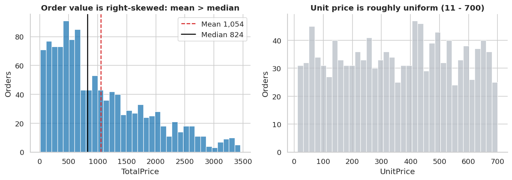
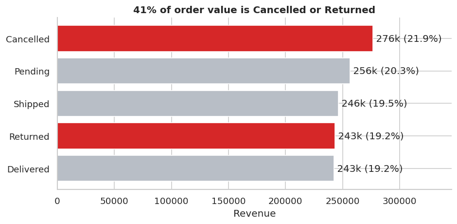
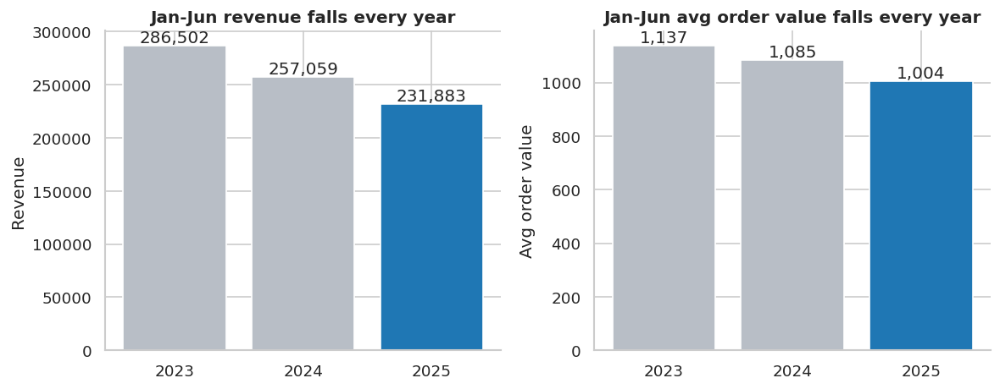
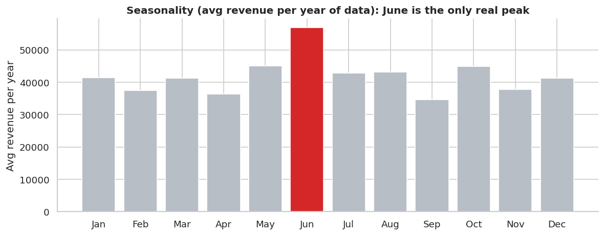
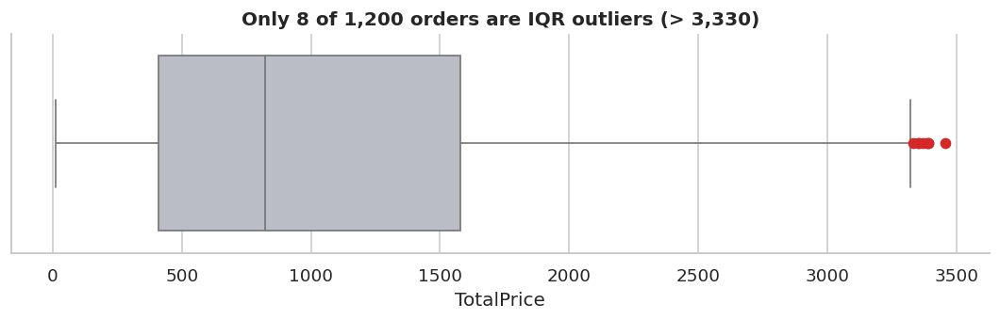
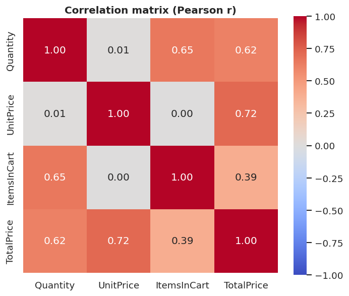
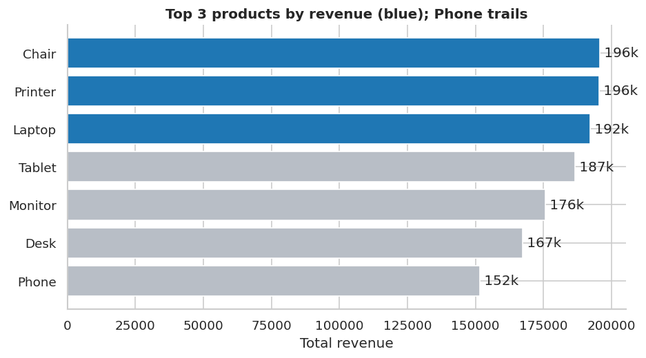

# Project 2: Exploratory Data Analysis (EDA) — E-commerce Orders

**DecodeLabs | Data Analytics Industrial Training Kit | Batch 2026**

> **Goal:** Analyze a dataset to understand patterns, trends and distributions.
> **Requirements covered:** basic statistics (mean, median, count) · trends & outliers · summary of key observations.

---

## 1. Problem Statement
ABC's e-commerce store recorded 1,200 orders between **1 Jan 2023 and 30 Jun 2025**. Before any dashboard or model is built:
*What does the order data look like, is it trustworthy, and what is it telling the business?*

## 2. Dataset
`data/ABC.xlsx` — 1,200 rows × 14 columns

| Column | Description |
|---|---|
| OrderID, TrackingNumber, CustomerID | Identifiers |
| Date | Order date |
| Product | Chair, Desk, Laptop, Monitor, Phone, Printer, Tablet |
| Quantity, UnitPrice, ItemsInCart, TotalPrice | Numeric fields |
| PaymentMethod, OrderStatus, CouponCode, ReferralSource, ShippingAddress | Categorical fields |

## 3. Methodology (IPO framework)
| Stage | What was done |
|---|---|
| **Input** | Loaded Excel, checked types, missing values, duplicates, and integrity (`TotalPrice = Quantity × UnitPrice`) |
| **Process** | Mean / median / count / five-number summary, skewness, IQR and Z-score outlier detection, monthly trend and like-for-like year comparison, Pearson correlation, chi-square tests |
| **Output** | 10 charts (`charts/`), 19 result tables (`outputs/`), findings below |

**Data forensics result:** no duplicate rows / OrderIDs / tracking numbers, no negative or impossible values, and `TotalPrice` matches `Quantity × UnitPrice` on all 1,200 rows. The only missing field is `CouponCode` (309 rows, 25.8%) — this means *no coupon used*, so it was labelled `No Coupon`, not dropped.

## 4. Basic Statistics
| Variable | Mean | Median | Min | Max | Skewness |
|---|---|---|---|---|---|
| Quantity | 2.95 | 3 | 1 | 5 | 0.03 |
| UnitPrice | 356.41 | 364.21 | 11.39 | 699.93 | -0.03 |
| ItemsInCart | 5.48 | 5 | 1 | 10 | 0.00 |
| **TotalPrice** | **1,053.97** | **823.62** | 11.39 | 3,456.40 | **0.89** |

Order counts are balanced across all 7 products (156–181 each), 5 payment methods, 5 order statuses and 5 referral sources. Total order value across all statuses: **1,264,762**.



## 5. Key Findings (headline first)

### 1) 41% of order value is Cancelled or Returned
Cancelled (250 orders, 276k) + Returned (247 orders, 243k) = **519.7k of 1,264.8k**. Only 38.7% of value is Delivered/Shipped; 20.3% is still Pending.


### 2) Like-for-like, revenue is falling ~10% every year
The data stops at June 2025, so Jan–Jun is compared across years:

| Jan–Jun | Orders | Revenue | Avg order value |
|---|---|---|---|
| 2023 | 252 | 286.5k | 1,136.9 |
| 2024 | 237 | 257.1k (**-10.3%**) | 1,084.6 (-4.6%) |
| 2025 | 231 | 231.9k (**-9.8%**) | 1,003.8 (-7.5%) |

Fewer orders **and** smaller baskets — AOV is down 11.7% in two years.


### 3) The "seasonality" in raw monthly totals is mostly an artifact — only June is a real peak
Jan–Jun has three years of data, Jul–Dec only two, so raw monthly sums make H1 look stronger. After dividing by years observed, every month sits at roughly 35k–45k except **June (~56.9k)**, which is the top month in all three years (45, 53 and 49 orders).


### 4) Order value is right-skewed — use the median, not the mean
Mean 1,054 vs median 824 (skew 0.89). The mean overstates the typical order by ~28%.

### 5) Outliers: 8 high-value orders — signal, not noise
IQR fence = 3,330. Eight orders exceed it (max 3,456), and **all have Quantity = 5** combined with a high unit price; they are valid (`Qty × Price` reconciles). The Z-score method flags **0** orders because the standard deviation is inflated by the skew — a good example of why IQR is preferred for business data. Kept in the dataset; worth a VIP/bulk-buyer review. `Quantity`, `UnitPrice`, `ItemsInCart` have no outliers.


### 6) Correlations (Pearson r) — and what they do *not* mean
| Pair | r |
|---|---|
| UnitPrice – TotalPrice | 0.72 |
| Quantity – TotalPrice | 0.62 |
| Quantity – ItemsInCart | 0.65 |
| UnitPrice – Quantity | 0.01 |

`TotalPrice` is computed from Quantity × UnitPrice, so those two correlations are **mechanical**, not discoveries. `ItemsInCart` is never lower than `Quantity` (0 violations), which explains its link with Quantity. Correlation is a clue, not a verdict.


### 7) Which splits are real? (chi-square vs OrderStatus)
| Variable | p-value | Significant (0.05)? |
|---|---|---|
| Product | 0.81 | No |
| PaymentMethod | 0.13 | No |
| CouponCode | 0.62 | No |
| **ReferralSource** | **0.005** | **Yes** |

Product, payment method and coupon differences in cancel/return rates are within random noise (e.g. "Online" has the lowest return rate, 14.7% vs 21–23%, but it is **not** statistically significant). Only referral source shows a real association with order status, and the pattern is mixed (e.g. Instagram has the lowest cancel rate at 15.8% but the most Pending at 26.6%), so it needs a closer look rather than a conclusion.

### 8) Product & channel performance
Chair (195.6k), Printer (195.6k) and Laptop (192.1k) lead revenue; **Phone is lowest (151.7k)** with the lowest median order (692). Instagram (275k) is the top channel; Referral (227k) is the lowest.


## 6. Recommendations
1. **Investigate cancellations/returns first** — 41% of value is at risk. The dataset has no reason code; add one (cancel/return reason) so the cause can be found.
2. **Diagnose the AOV decline** (-11.7% in 2 years) — check product mix, discounting and basket size; test bundles or free-shipping thresholds.
3. **Prepare for June** — it is the only consistent peak; plan stock and campaigns around it.
4. **Review the 8 high-value orders** for bulk/VIP treatment.
5. **Fix data capture:** `TotalPrice` ignores coupons (it equals Qty × UnitPrice even when a coupon was used), so discount impact cannot be measured.

## 7. Limitations
- Data ends 30 Jun 2025 (partial year) — only like-for-like comparisons are valid.
- `TotalPrice` is pre-discount; `ShippingAddress` is always "<number> Main St"; categories are almost perfectly balanced, so the dataset may be simulated/synthetic. Real-world business conclusions should be validated on live data.
- 11 customers placed 2 orders each; too few repeat buyers to analyse retention.

## 8. How to Run
```bash
git clone <your-repo-url>
cd project2-eda
pip install -r requirements.txt
python eda_analysis.py
```
Charts are saved to `charts/` and tables to `outputs/`.

## 9. Repository Structure
```
project2-eda/
├── data/ABC.xlsx
├── eda_analysis.py
├── charts/        # 10 PNG charts
├── outputs/       # 19 CSV result tables
├── requirements.txt
└── README.md
```

**Skills:** Data analysis · Descriptive statistics · Outlier detection · Correlation analysis · Analytical thinking (Python, pandas, matplotlib, seaborn, scipy)
